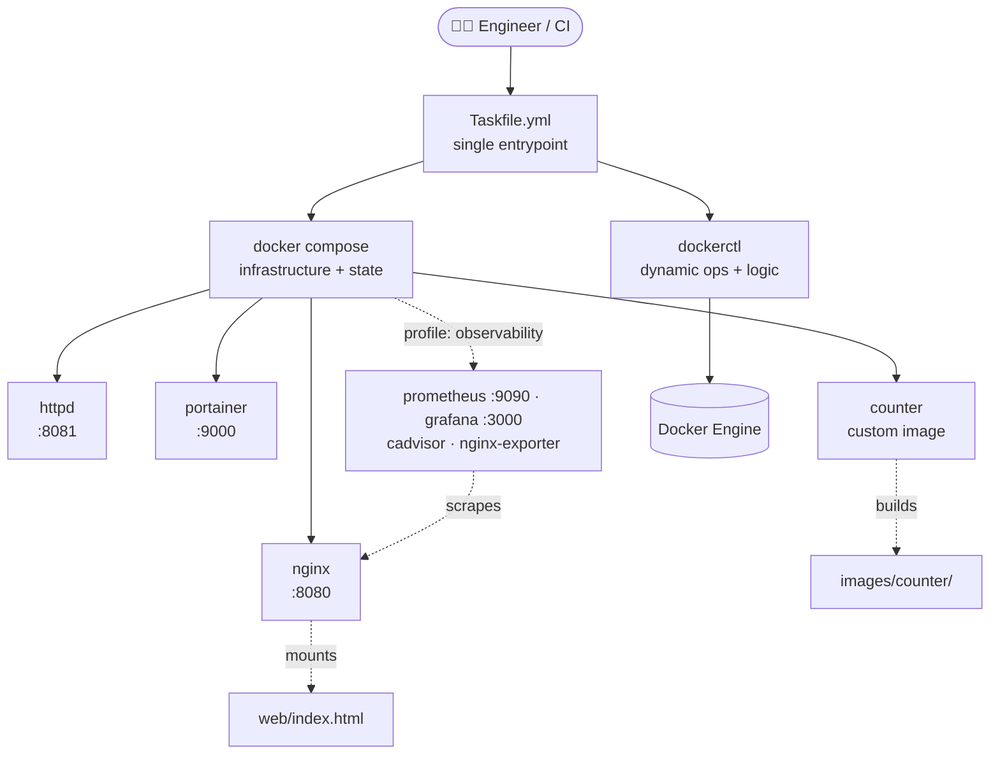

<div align="center">

# 🐳 dockerctl a hardened Docker operations toolkit

**Typed Python CLI · declarative hardened compose stack · supply-chain-gated CI**
*CLI פייתון מטופס · סטאק compose מוקשח ודקלרטיבי · CI עם שערי אבטחת שרשרת-אספקה*

[](https://github.com/www8351/Docker-DevOps-Tooling/actions/workflows/ci.yml)
[](https://github.com/www8351/Docker-DevOps-Tooling/actions/workflows/release.yml)
[](https://github.com/www8351?tab=packages&repo_name=Docker-DevOps-Tooling)


</div>

---

## 🌍 What is this? · מה זה?

<table>
<tr>
<td width="50%" valign="top">

### 🇬🇧 English

A production-grade Docker toolkit: **compose owns state**, a **typed Python CLI** owns
dynamic operations, a **Taskfile** glues them, and **CI enforces everything**. Every
long-running container runs on a **read-only root filesystem with dropped capabilities and
`no-new-privileges`**, most run as non-root users, published ports bind to **loopback** by
default, and admin passwords come from **generated secrets**.

</td>
<td width="50%" valign="top">

<div dir="rtl">

### 🇮🇱 עברית

ערכת כלים ל-Docker ברמת production: **compose מחזיק את המצב**, **CLI פייתון מטופס** מחזיק
את הפעולות הדינמיות, **Taskfile** מחבר ביניהם, ו-**CI אוכף הכול**. כל קונטיינר ארוך-טווח
רץ עם **מערכת קבצים לקריאה בלבד, הפלת יכולות ו-`no-new-privileges`**, רובם רצים ללא root,
הפורטים נקשרים כברירת מחדל ל-**loopback**, וסיסמאות הניהול מגיעות מ-**סודות שנוצרים אוטומטית**.

</div>

</td>
</tr>
</table>

```console
$ docker ps --format 'table {{.Names}}\t{{.Image}}\t{{.Status}}\t{{.Ports}}'
NAMES                 IMAGE                                           STATUS                    PORTS
compose-counter-1     compose-counter                                 Up 28 seconds (healthy)
compose-httpd-1       httpd:2.4.69-alpine3.24                         Up 28 seconds (healthy)   127.0.0.1:8081->8080/tcp
compose-nginx-1       nginxinc/nginx-unprivileged:1.30.6-alpine3.24   Up 28 seconds (healthy)   127.0.0.1:8080->8080/tcp
compose-portainer-1   portainer/portainer-ce:2.39.8                   Up 28 seconds             8000/tcp, 9443/tcp, 127.0.0.1:9000->9000/tcp
```

## ⚡ Highlights

- **78 MB Ubuntu → ~7 MB hardened Alpine** the [before/after](#-counter--from-78-mb-of-attack-surface-to-a-few-mb) of the counter image
- **Read-only containers, `cap_drop: ALL`, `no-new-privileges`, loopback ports, generated admin secrets** see [`compose/docker-compose.yml`](compose/docker-compose.yml)
- **SHA-pinned actions, Trivy gate, CycloneDX SBOMs** see [`ci.yml`](.github/workflows/ci.yml)
- **Typed CLI: mypy strict, 45 tests, 100% coverage** see [`cli/`](cli/)
- **Released [v0.2.1](https://github.com/www8351/Docker-DevOps-Tooling/releases/tag/v0.2.1)** — multi-arch, cosign-signed, attested images on GHCR + a [CHANGELOG](CHANGELOG.md)

---

## 💡 Why this exists

This repo began as a set of **interactive bash menus** written years ago to learn Docker.
They worked at a keyboard, but they were fragile and impossible to automate. Everything was
rebuilt as declarative config, a flag-driven CLI, and CI validation on every pull request.

The result is **non-interactive, reproducible, and pipeline-safe**.

---

## 🏗 Architecture



**Separation of concerns** each tool owns exactly one job:

| Layer | Owns | Tool |
|-------|------|------|
| 🧱 Infrastructure | container lifecycle, networks, volumes, state | `docker-compose` |
| 🐍 Logic | dynamic image/container ops, error handling | Python + Typer |
| ▶️ Orchestration | day-to-day commands | Taskfile |
| 🤖 Quality gate | validation, no humans | GitHub Actions |

---

## 📂 Project layout

```
.
├── compose/
│   ├── docker-compose.yml   # declarative stack (nginx, httpd, portainer, counter)
│   └── .env.example         # bind addresses + ports  →  copy to .env
├── images/
│   └── counter/             # custom image, built by compose
│       ├── Dockerfile       # multi-stage, hardened, Alpine, non-root
│       └── counter.sh       # POSIX sh (no bash needed)
├── web/
│   └── index.html           # served by nginx from a read-only mount
├── cli/                     # dockerctl — non-interactive Python CLI
│   ├── Dockerfile           # multi-stage build → slim Alpine, non-root
│   ├── .dockerignore
│   ├── pyproject.toml
│   └── dockerctl/
│       ├── __main__.py      # entrypoint + subcommand wiring
│       ├── _docker.py       # typed wrapper around the docker CLI
│       ├── images.py        # pull / rm
│       └── containers.py    # ls / rm / deploy
├── Taskfile.yml             # engineering entrypoint
└── .github/workflows/ci.yml # lint, test, scan and boot the stack on every PR
```

---

## ✅ Requirements

| Tool | Why | Install |
|------|-----|---------|
| Docker Engine + Compose v2 | run the stack | <https://docs.docker.com/get-docker/> |
| Python ≥ 3.11 | run `dockerctl` | <https://www.python.org/> |
| uv (recommended) | locked dev environment, pre-commit hooks | <https://docs.astral.sh/uv/> |
| Task (optional) | task runner | <https://taskfile.dev/installation/> |

> Without Task installed, every command has a raw `docker compose` equivalent shown below.

---

## 🚀 Quick start

```bash
# 1. configure bind addresses / ports
cp compose/.env.example compose/.env

# 2. generate the admin passwords (compose/secrets/, never committed)
task secrets            # or: scripts/gen-secrets.sh

# 3. start everything in the background and wait until it is healthy
task up                 # or: docker compose -f compose/docker-compose.yml up -d --wait

# 4. open the services (bound to 127.0.0.1 unless you change WEB_BIND_ADDR / ADMIN_BIND_ADDR)
#    nginx     → http://localhost:8080
#    httpd     → http://localhost:8081
#    portainer → http://localhost:9000   user admin, password in compose/secrets/portainer_admin_password

# 5. tear down
task down               # or: docker compose -f compose/docker-compose.yml down
```

---

## 🧱 The stack (docker-compose)

Defined in [`compose/docker-compose.yml`](compose/docker-compose.yml). Bind addresses and
ports come from `compose/.env`; every image is **pinned by tag and digest** in the compose
file itself, where Dependabot can bump it.

| Service | Image | Default port | Health | Network | Runs as | Notes |
|---------|-------|--------------|--------|---------|---------|-------|
| `nginx` | `nginxinc/nginx-unprivileged:1.30.6-alpine3.24` | `127.0.0.1:8080` | `wget` probe | `web`, `nginx-status` | UID 101 | serves `web/` read-only, no capabilities |
| `httpd` | `httpd:2.4.69-alpine3.24` | `127.0.0.1:8081` | `wget` probe | `web` | UID 82 (`www-data`) | [`compose/httpd/httpd.conf`](compose/httpd/httpd.conf) on port 8080, no capabilities |
| `portainer` | `portainer/portainer-ce:2.39.8` | `127.0.0.1:9000` | none (scratch image) | `mgmt` | root | Docker UI; admin from a generated secret |
| `counter` | built from `images/counter/` | none | heartbeat probe | none | UID 10001 | incrementing counter; hardened Alpine (see [suite](#-devops-tooling--containerization-suite)) |

Every service runs with a **read-only root filesystem** (tmpfs for known write paths),
`cap_drop: ALL` with nothing added back, `no-new-privileges`, CPU/memory limits,
and bounded json-file logging. Published ports bind to `WEB_BIND_ADDR` (nginx, httpd) and
`ADMIN_BIND_ADDR` (portainer, prometheus, grafana), both `127.0.0.1` by default. Portainer is
the only service in the default stack holding docker.sock, alone on the `mgmt` network (the
`dockerctl` tool gets it only when you run it with the socket mounted). Admin passwords for
Portainer and Grafana are read from `compose/secrets/` (created by `task secrets`); there is
no default password, so `up` fails if the files are missing. Both apps only read the secret
when their data volume is first created. The alpine tags are load-bearing: busybox `wget`
powers the healthchecks.

### 📈 Observability profile

```bash
task obs:up             # or: docker compose -f compose/docker-compose.yml --profile observability up -d --wait
# prometheus → http://localhost:9090      grafana → http://localhost:3000 (admin, compose/secrets/grafana_admin_password)
```

| Service | Image | Port | Runs as | Role |
|---------|-------|------|---------|------|
| `prometheus` | `prom/prometheus:v3.13.4` | `127.0.0.1:9090` | `nobody` | scrapes cadvisor + nginx-exporter every 15s |
| `grafana` | `grafana/grafana:12.4.13` | `127.0.0.1:3000` | UID 472 | **provisioned** datasource + committed [container dashboard](compose/grafana/dashboards/containers.json), zero click-ops |
| `cadvisor` | `gcr.io/cadvisor/cadvisor:v0.55.1` | none | root, no capabilities | per-container CPU/memory metrics from the host cgroup tree |
| `nginx-exporter` | `nginx/nginx-prometheus-exporter:1.5.3` | none | UID 1001 | nginx `stub_status` → Prometheus metrics |

All four run read-only with `cap_drop: ALL`, `no-new-privileges`, memory limits and
digest-pinned images, on their own `metrics` network; the exporter reaches nginx over the
internal `nginx-status` network and never joins `web`. cAdvisor gets **no engine socket**:
its Docker integration needs both docker.sock and the containerd socket, and either one is
root-equivalent. It mounts only `/sys` read-only, so the dashboard labels containers by the
short id `docker ps` prints instead of by name, and per-container network counters are not
collected. CI boots this profile too and fails the build if any Prometheus target is down or
cAdvisor stops attributing metrics to containers. Deliberately out of scope: Alertmanager
and Loki.

```bash
task build    # docker compose --profile tools build  (counter + dockerctl)
task pull     # docker compose pull
task logs     # docker compose logs -f
task clean    # down + remove volumes
```

---

## 🛡 DevOps Tooling & Containerization Suite

Two purpose-built images, each authored as a **multi-stage build on a minimal Alpine base
and run by an unprivileged user**. The goal is small, reproducible, and low-attack-surface
the build toolchain never reaches the final image, and neither does root.

| Image | Source | Base | Multi-stage layout | Runs as |
|-------|--------|------|--------------------|---------|
| `counter` | [`images/counter/`](images/counter/) | `alpine:3.24` (digest pinned) | `lint` (shellcheck gate) → `runtime` | non-root `app` (UID 10001) |
| `dockerctl` | [`cli/`](cli/) | `python:3.14-alpine3.24` (digest pinned) | `builder` (venv from `uv.lock`) → `runtime`, one shared base | non-root `app` (UID 10001) |

### 🔢 `counter` from 78 MB of attack surface to a few MB

The original image ran a trivial bash loop on `ubuntu:24.04` while installing
`openssh-server`, `sshpass`, `tcpdump`, `net-tools`, and `python3` — **none of which the
script uses**. `sshpass` and `tcpdump` alone are exactly what an image scanner flags first.

| | Before ❌ | After ✅ |
|--|----------|---------|
| Base | `ubuntu:24.04` (~78 MB) | `alpine:3.24` (~7 MB) |
| Extra packages | ssh, sshpass, tcpdump, net-tools, python3 | none |
| User | root | non-root `app` (UID/GID 10001) |
| Stages | 1 | 2 (lint gate → runtime) |
| Script | bash + dead `/var/log/my` symlinks | POSIX `sh`, no bash needed |

**Hardening choices**
- **Build-time lint gate** stage 1 runs `shellcheck` against `counter.sh`; a broken script
  fails `docker build`, so bad shell never reaches an image.
- **Carry only what runs** the runtime stage copies *just* the validated script; every package
  from the old image is gone.
- **Non-root by construction** a fixed-ID `app` user owns nothing it doesn't need; the script
  is installed read-and-execute only (`0555`).
- **POSIX `sh`** rewriting the one bashism (`((counter++))` → `$((counter + 1))`) lets it run on
  Alpine's busybox `ash`, so no `bash` package is installed at all.
- **A healthcheck that can fail** the loop touches a heartbeat file in `/tmp` every iteration and
  `counter.sh --healthcheck` fails once it is older than 10 seconds. The image declares it as its
  `HEALTHCHECK`, and compose runs the same command. Running it with `--read-only` therefore needs
  a writable `/tmp` (`--tmpfs /tmp`, as compose does).

### 🐍 `dockerctl` multi-stage Python, no toolchain in the runtime

```bash
docker compose --profile tools build dockerctl      # or: docker build -t dockerctl cli

docker run --rm dockerctl version                   # prints the packaged version (no socket needed)
docker run --rm dockerctl images --help

# drive the real engine by mounting the host socket:
docker run --rm -v /var/run/docker.sock:/var/run/docker.sock \
  dockerctl images pull nginx:latest
```

**Hardening choices**
- **Builder/runtime split on one base** both stages start from the same digest-pinned
  `python:3.14-alpine3.24` image, because a venv only works with the interpreter and libc it was
  built for. The runtime copies only the venv; pip is removed from the runtime interpreter and
  the venv never had it, so it never ships.
- **Locked dependencies** the `builder` installs exactly what [`cli/uv.lock`](cli/uv.lock) pins
  (hash-checked) with uv from its own digest-pinned image, in a layer that only rebuilds when the
  lock changes; uv itself never reaches the runtime.
- **Minimal runtime** the shared base plus only `docker-cli` (the client, not a daemon),
  because `dockerctl` shells out to `docker` (see [`cli/dockerctl/_docker.py`](cli/dockerctl/_docker.py)).
- **Non-root `app` user** and a lean build context via [`cli/.dockerignore`](cli/.dockerignore)
  (tests, caches, and the Dockerfile itself are excluded).
- **No socket baked in** the engine is reached only through an explicitly mounted
  `/var/run/docker.sock` at run time, so the image grants itself nothing.

### 🔎 Scanned in CI

Both images are built and scanned by **Trivy** on every pull request and merge (see
[CI](#-continuous-integration)). The scan **gates on HIGH/CRITICAL** findings
(`ignore-unfixed: true`, so unpatchable upstream base CVEs don't break the build).

---

## 🐍 The CLI (dockerctl)

A small **non-interactive** CLI for the dynamic operations compose shouldn't own
(ad-hoc pulls, removals, one-off deploys) plus the stack's lifecycle. Flags only, no prompts,
so it is safe in CI. Every command returns a meaningful **exit code** and writes errors to
stderr, and every value you pass reaches docker after a `--`, so a name starting with a dash
is never read as a docker flag.

```bash
cd cli && uv sync --locked    # locked environment with the `dockerctl` command (uv run dockerctl …)
pip install -e cli            # or: plain pip, resolving unpinned versions
```

```bash
dockerctl compose up --profile observability   # start the stack and wait until it is healthy
dockerctl containers deploy nginxinc/nginx-unprivileged:1.30.6-alpine3.24 -n web -p 8080:8080
dockerctl containers stats --json
dockerctl images push ghcr.io/acme/counter:1.0
dockerctl --version           # or -V, or the `version` subcommand
```

**`containers deploy` is hardened by default**: `no-new-privileges`, every capability dropped,
a read-only root filesystem with `/tmp` on tmpfs, `--pids-limit 256`, `--memory 256m`, and the
port published on `127.0.0.1` unless the mapping names an address (`0.0.0.0:8080:80`); an empty
address (`:8080:80`) also gets `127.0.0.1`. Images that need more ask for it:
`--cap-add NET_BIND_SERVICE`, `--tmpfs /var/cache/nginx`, `--writable`, `--user 101:101`,
`--memory 512m`, `--pids-limit 1024`. `--tmpfs /tmp:size=64m` replaces the default `/tmp`
mount. `--no-harden` gives a plain `docker run -d` with only `--name`, `--port` and `--user`,
and refuses the other options rather than ignore them.

**`compose` runs on the host**: it wraps `docker compose -f compose/docker-compose.yml`
(relative to where you run it; set `--file` or `DOCKERCTL_COMPOSE_FILE` otherwise) and needs the
Docker Compose plugin, which the `dockerctl` image does not ship (inside the image these
commands exit 1 with docker's own usage error). Unlike `docker compose`, `--file` and
`--profile` go after the subcommand: `dockerctl compose ps --profile observability`.

<details>
<summary><b>Full command reference</b> (3 groups, 19 commands)</summary>

| Command | Replaces | Example |
|---------|----------|---------|
| `images ls [--json]` | menu listing | `dockerctl images ls --json` |
| `images build <path> -t <tag>` | build menus | `dockerctl images build images/counter -t counter:dev` |
| `images pull <ref>` | `pull_images.sh` | `dockerctl images pull nginx:latest` |
| `images rm <id> [-f]` | `remove_images.sh` | `dockerctl images rm nginx:latest` |
| `images tag <src> <target>` | — | `dockerctl images tag counter:dev ghcr.io/acme/counter:1.0` |
| `images push <ref>` | — | `dockerctl images push ghcr.io/acme/counter:1.0` |
| `containers ls [-a] [--json]` | menu listing | `dockerctl containers ls --all` |
| `containers rm <id> [-f]` | `remove_Container.sh` | `dockerctl containers rm web --force` |
| `containers deploy ` | deploy menus | `dockerctl containers deploy nginxinc/nginx-unprivileged:1.30.6-alpine3.24 -n web -p 8080:8080` |
| `containers logs / stop / start / restart` | menu ops | `dockerctl containers restart -t 5 web` |
| `containers exec / inspect / stats` | menu ops | `dockerctl containers stats --json` |
| `compose up [services] [--profile p] [--no-wait]` | `docker compose up -d --wait` | `dockerctl compose up --profile observability` |
| `compose down [-v]` | `docker compose down` | `dockerctl compose down --volumes` |
| `compose ps [-a] [--json]` | `docker compose ps` | `dockerctl compose ps --json` |

`dockerctl --help` prints the full command tree; each group has its own `--help`.

</details>

The CLI is **mypy-strict clean** and its test suite is **coverage-gated at
90%** (currently 100%), tested on Python 3.11 to 3.14; the version is single-sourced from
`pyproject.toml` and every dependency is locked in `cli/uv.lock`.

---

## ▶️ Task runner

[`Taskfile.yml`](Taskfile.yml) is the one entrypoint everyone (and CI) uses.

```bash
task            # list all tasks
task secrets    # generate missing admin passwords
task up         # start the stack and wait for health
task obs:up     # stack + observability profile
task down       # stop + remove
task build      # build images
task pull       # pull images
task logs       # tail logs
task clean      # down + volumes
task lint       # run every linter locally
task cli -- compose ps                 # proxy to dockerctl (runs from the repo root)
```

---

## 🤖 Continuous integration

[`.github/workflows/ci.yml`](.github/workflows/ci.yml) runs on every pull request and every push
to `main`, **fully unattended**, under least-privilege permissions, with every action **pinned to
a commit SHA**, a timeout on every job, and no checkout keeping its token:

**`lint` job** (Python 3.11, the oldest supported)
1. ✅ **Compose** `docker compose config` validates the stack, and every published port must bind to loopback
2. 🐳 **Dockerfiles** `hadolint` lints both `images/counter/Dockerfile` and `cli/Dockerfile`
3. 🐚 **Shell** `shellcheck` on shell scripts
4. 🐍 **Python** `ruff` lint + format check, from the exact versions in `cli/uv.lock`
5. 🔍 **Types** `mypy` in strict mode
6. 📦 **Tests** `pytest` with a 90% coverage gate

**`test` job** runs the same locked suite on Python 3.12, 3.13 and 3.14.

**`workflow-lint` job** runs `actionlint` (with shellcheck on every `run:` block) and
`zizmor`'s security audits of the workflows, including its online checks for known-vulnerable or
impostor action commits.

**`image` job** (matrix: counter, dockerctl)
- builds via buildx with GitHub Actions **layer caching** and runs the dockerctl entrypoint
- scans with **Trivy** (gates HIGH/CRITICAL, `ignore-unfixed`) and uploads the findings to
  **code scanning** as SARIF
- generates a **CycloneDX SBOM** per image, uploaded as an artifact

**`stack-test` job**
- first asserts the stack **fails closed**: Portainer and Grafana must refuse to start without their secrets
- boots the hardened stack **with the observability profile** via `docker compose up -d --wait`,
  so every healthcheck becomes a CI assertion
- probes the web and observability endpoints, checks that the generated admin passwords work
  and `admin:admin` does not, waits for every Prometheus target and for cAdvisor's
  per-container series, then runs the built `dockerctl` image against the runner's live
  Docker socket

**`publish` job** (pushes to `main` only) calls the shared
[`_publish.yml`](.github/workflows/_publish.yml), which never tags anything it has not checked:
1. builds `linux/amd64` + `linux/arm64` with BuildKit provenance and SBOM attestations and pushes
   **by digest only**
2. scans **that digest on both platforms** with Trivy
3. signs the digest with **cosign** (keyless, OIDC)
4. points `latest` + the short commit SHA at it and fails unless every tag resolves to the scanned digest

On pull requests, **`publish-dry-run`** runs the same workflow against a throwaway local registry
(no signing), so a broken publish fails the PR instead of `main`.
[`codeql.yml`](.github/workflows/codeql.yml) analyses the Python code and the workflows.

[Dependabot](.github/dependabot.yml) keeps GitHub Actions (one grouped PR), `cli/uv.lock`, both
Dockerfiles (including the pinned uv stage), and the digest-pinned compose images updated
weekly, each waiting 7 days after a release before proposing it.

---

## 🚢 Releases & published images

Tagging `vX.Y.Z` fires [`release.yml`](.github/workflows/release.yml). It first checks the tag
against `cli/pyproject.toml` (and, for stable releases, that `CHANGELOG.md` has its section), then
runs the **whole CI suite** on the tagged commit, then publishes through the same scan, sign and
tag workflow as `main`: multi-arch, cosign-signed, semver-tagged images on GHCR plus a GitHub
Release. Tags with a prerelease part (`v0.3.0-rc.1`) are marked as prereleases and never move
`latest` or `major.minor`. The current
released version is **0.2.1**. Curated notes live in
[CHANGELOG.md](CHANGELOG.md).

```bash
docker pull ghcr.io/www8351/docker-devops-tooling/dockerctl:0.2.1
docker pull ghcr.io/www8351/docker-devops-tooling/counter:0.2.1
```

---

## 🎯 Design principles

- **Declarative over imperative** compose describes the desired state; we don't script `docker run`.
- **No interactivity** flags and env vars only, so everything works in a pipeline.
- **Meaningful exit codes** failures fail loudly and stop CI.
- **One entrypoint** Taskfile, so nobody memorizes long commands.
- **Right tool per job** compose for infra, Python for logic, Task to glue, CI to enforce.

---

## 🧰 Troubleshooting

<details>
<summary><b>Common issues and fixes</b></summary>

| Symptom | Fix |
|---------|-----|
| `task: command not found` | Install Task, or use the `docker compose …` equivalents above. |
| Port already in use | Change the port in `compose/.env` and re-run `task up`. |
| `bind source path does not exist: …/compose/secrets/…` | Run `task secrets` (or `scripts/gen-secrets.sh`) before `up`. |
| Admin password from `compose/secrets/` is rejected | Grafana and Portainer read it only when their data volume is first created. Reset it in the UI, or `task clean` to start over. |
| Services unreachable from another machine | Ports bind to `127.0.0.1` by default; set `WEB_BIND_ADDR` / `ADMIN_BIND_ADDR` in `compose/.env`. |
| Page looks unstyled | Hard-refresh; `web/index.html` is mounted live (no rebuild needed). |
| `dockerctl: command not found` | Run `cd cli && uv sync --locked` and use `uv run dockerctl …` (or `pip install -e cli`). |
| Permission denied on docker socket | Add your user to the `docker` group, or run with `sudo`. |
| `dockerctl` container can't reach the socket | The image is non-root; grant it the socket's group: `docker run --group-add "$(stat -c '%g' /var/run/docker.sock)" …` |
| A service is unhealthy / crash-looping | Check `docker compose ps` + `task logs`; the stack runs read-only see the tmpfs lists in the compose file. |

</details>

---

## 🤝 Contributing / Security / Changelog

- [CONTRIBUTING.md](CONTRIBUTING.md) setup, quality gates, conventions, release steps
- [SECURITY.md](SECURITY.md) reporting vulnerabilities, security posture
- [CHANGELOG.md](CHANGELOG.md) curated, Keep-a-Changelog format

---

<div align="center">
<sub>From interactive bash menus to a supply-chain-gated toolkit — the <a href="CHANGELOG.md">CHANGELOG</a> tells the story.</sub>
</div>
